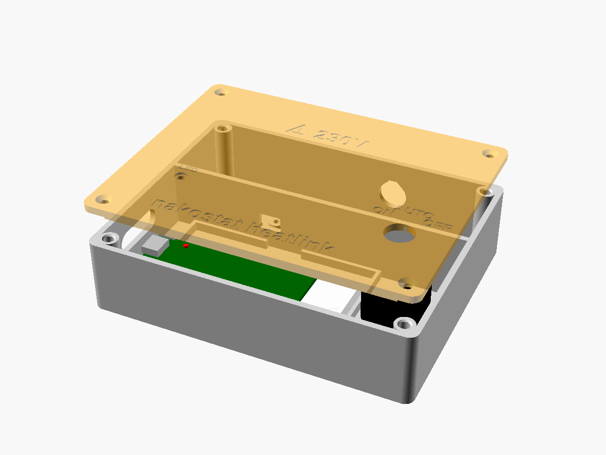
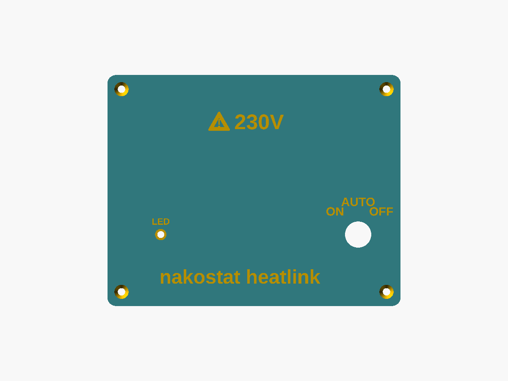
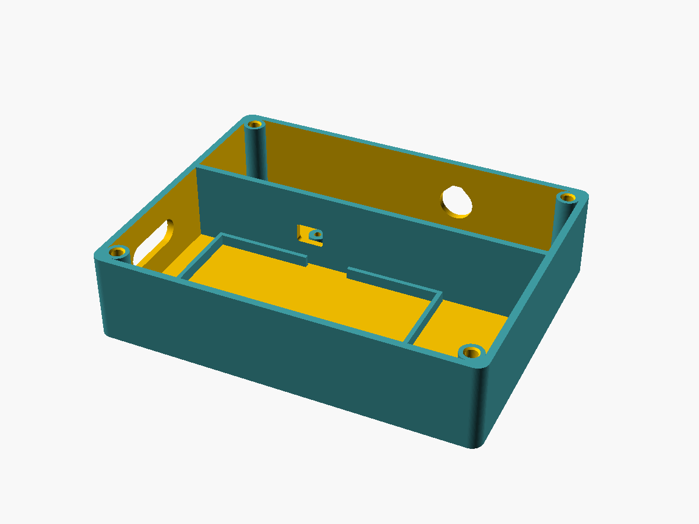
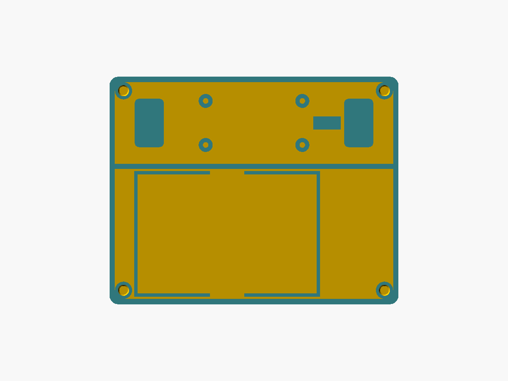
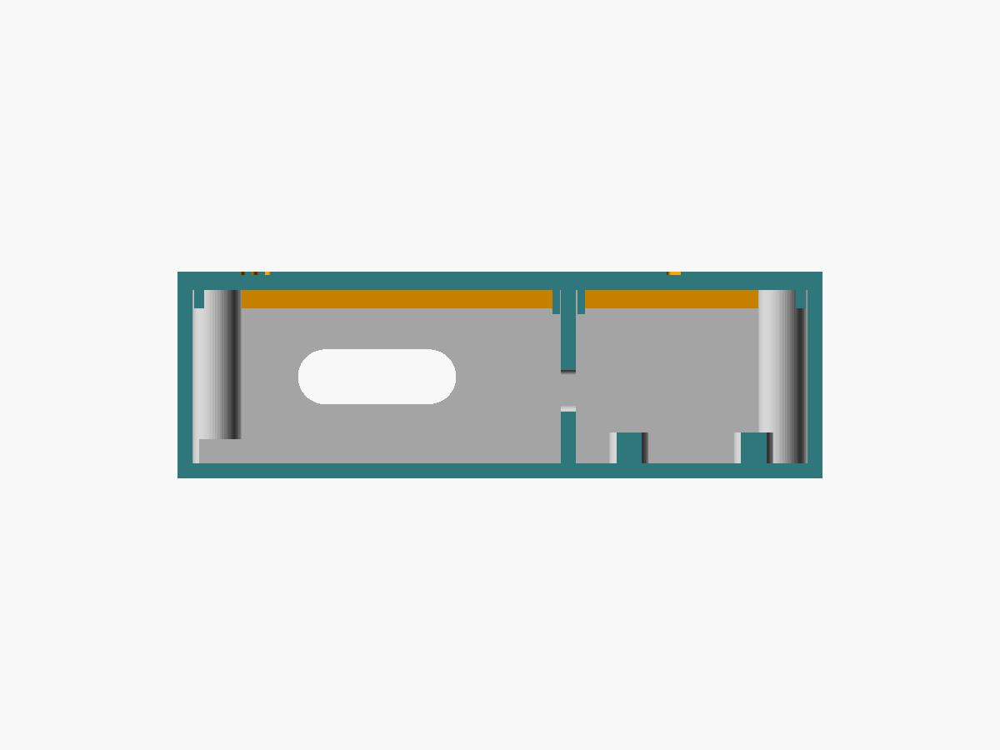

# Heatlink v2 prototype case

A two-part printed case for the heatlink v2 breadboard prototype (STAT-72, part of STAT-69). The
**base** holds the half-size breadboard with the ESP32-S3-DevKitC-1 on the low-voltage side, and the
single-channel relay module in its own **mains compartment** behind a full-height barrier. The **lid**
carries the auto / off / on switch and a window for the DevKitC's RGB status LED.

| Assembly (lid lifted) | Lid (top face) |
|---|---|
|  |  |
| **Base** | **Base, plan view** |
|  |  |

Section through the barrier's low-voltage pass-through (USB slot on the left, lid ribs straddling the
barrier, relay standoffs on the right):



Outer size with the defaults: **134.5 × 105.9 × 34 mm** (base 31 mm tall, lid 3 mm).

## Files

| File | What |
|---|---|
| `heatlink-case.scad` | The model. `part` = `base`, `lid`, `assembly`, `section`, `check`, `rib_overlap` |
| `params.scad` | Every dimension, with defaults for common parts |
| `make.sh` | Renders the STLs, PNG previews and fit checks into `out/` |
| `out/heatlink-case-base.stl`, `out/heatlink-case-lid.stl` | Print-ready, already in print orientation |

## Layout

Looking down on the base with the lid off, USB end on the left:

```
 back (y+)   ┌──────────────── PG7 gland ──────────────┐
             │ keyhole   [ relay module  ]●   keyhole  │  mains compartment
             │           header▲    terminals          │
             ╞══════════ barrier (pass-through ▲) ═════╡  full height, lid ribs either side
             │ USB ┌──────────────────────┐  switch    │
 USB slot ◄──┤     │ breadboard + DevKitC │   bay      │  low-voltage side
             │     └──────────────────────┘            │
 front (y-)  └─────────────────────────────────────────┘
```

- The relay module's **header end** faces the breadboard; the low-voltage pass-through in the barrier
  sits at that end, more than 25 mm from the screw terminals (an `assert` enforces it).
- The **gland** is in the back wall, in line with the screw terminals. Mount the case **gland down**.
- The lid has two **ribs** that straddle the top of the barrier (tongue in groove), so there is no
  straight path from the mains side to the low-voltage side even at the lid joint.
- The **keyholes** are in the mains compartment floor under closed roofs, so the wall screws' heads are
  boxed in plastic and never exposed inside the compartment.
- The **USB slot** (26 × 9 mm) covers both of the DevKitC's USB-C ports.

## Parameters

All in `params.scad`; override on the command line with `./make.sh -D 'name=value'`.

| Parameter | Default | Notes |
|---|---|---|
| `bb` | `[82.5, 54.5, 8.5]` | Half-size breadboard L × W × H |
| `bb_clr` | 0.4 | Pocket clearance per side |
| `headroom` | 20 | Clear height above the breadboard to the lid |
| `devkit_x_off` | −2 | DevKitC USB edge relative to the breadboard end (negative = overhangs) |
| `usb_z_above_bb` | 5.7 | USB-C centre above the breadboard top |
| `usb_slot` | `[26, 9]` | USB slot width × height |
| `led_from_usb`, `led_dy` | 13, 0 | RGB LED position on the DevKitC (**measure**) |
| `led_hole_d`, `led_cbore` | 3.2, `[5.2, 1]` | LED window; counterbore for a light-pipe flange |
| `relay_pcb` | `[50, 26]` | Relay module PCB, header → terminals × width (**measure**) |
| `relay_holes` | `[45, 20.5]` | Mounting hole spacing (**measure**) |
| `relay_h` | 19 | Tallest part above the relay PCB |
| `relay_standoff` | 5 | Standoff height |
| `relay_screw_d` | 2.6 | Standoff hole (self-tap M3, or M2.5 machine screw) |
| `barrier_t` | 2.4 | Barrier wall thickness |
| `pass_size`, `pass_z` | `[10, 7]`, 12 | Low-voltage pass-through size and height |
| `gland_d` | 12.5 | PG7. PG9 = 15.5, M16 = 16.2 |
| `gland_z`, `gland_from_terminals_end` | 12.5, 6 | Gland centre height; position in from the terminal end |
| `wall`, `floor_t`, `lid_t` | 2.5, 2.5, 3 | Shell |
| `insert_d`, `insert_depth` | 4.0, 5.7 | M3 heat-set insert holes |
| `pilot`, `pilot_d` | false, 2.5 | Self-tap holes instead of inserts |
| `screw_head` | `"csk"` | `"csk"` (countersunk) or `"cbore"` (counterbored, pan/cap head) |
| `switch_type` | `"rotary"` | `"rotary"` or `"toggle"` (changes the label layout) |
| `switch_hole_d` | 12 | 12 for a typical rotary bushing; 6.2 for a mini toggle |
| `anti_rot`, `anti_rot_r`, `anti_rot_angle` | true, 7.5, 90 | Blind hole for the switch's anti-rotation tab (**measure**) |
| `kh_*` | | Keyhole slots: 8.5 mm head, 4.2 mm shank, for No. 6–8 / 3.5–4 mm pan-head screws |
| `fit_clr`, `lip_h`, `rib_h` | 0.25, 3, 4 | Lid fit |

Example, for a mini toggle and a PG9 gland:

```sh
./make.sh -D 'switch_type="toggle"' -D 'switch_hole_d=6.2' -D 'gland_d=15.5'
```

## Measure before printing

The defaults are common parts; check Martin's actual ones and re-run `./make.sh` with overrides (or
edit `params.scad`):

1. **Relay module**: PCB length × width (`relay_pcb`), mounting-hole centre spacing (`relay_holes`),
   height of the tallest part above the PCB (`relay_h`), and which end the screw terminals are at
   (the model assumes header at one short end, terminals at the other).
2. **Switch**: bushing diameter (`switch_hole_d`; add ~0.3 mm), anti-rotation tab radius from the
   bushing centre (`anti_rot_r`), body diameter and depth behind the panel (`switch_body_d`,
   `switch_body_depth`; must fit the 34 mm switch bay and 28.5 mm interior).
3. **DevKitC RGB LED**: distance from the USB edge of the board to the LED centre (`led_from_usb`), and
   its offset from the board's centre line (`led_dy`, positive = towards the barrier). Also how far the
   USB-C sockets overhang the breadboard end once it is plugged in (`devkit_x_off`).
4. **Breadboard**: brands vary a little (`bb`).
5. **Gland**: thread size (`gland_d`) and locknut across flats (`gland_nut_af`, used for a clearance check).

The `.scad` files carry `assert`s for the clearances that matter (barrier pass-through away from the
terminals, gland nut clear of bosses and keyhole pads, relay and switch fit the height, holes clear of the
lid lip), so a bad override fails loudly rather than producing a quietly broken STL.

## Rendering

```sh
./make.sh            # needs OpenSCAD 2026.09+ (set OPENSCAD=... if it isn't on the usual path)
```

`make.sh` fails on any OpenSCAD warning or error, on a non-manifold result, if the base and lid
intersect when closed (`part="check"` must render empty), or if the lid ribs don't reach over the barrier
(`part="rib_overlap"` must render non-empty). The bosses and lid holes come from the same position list,
so they cannot drift apart.

## Printing

- **Material: PETG or ASA, not PLA.** It sits next to a boiler and PLA softens around 55–60 °C.
- 4 perimeters, 4 top/bottom layers, 20–25 % infill, 0.2 mm layers.
- Both STLs are already in print orientation, flat side down, and need **no supports**: the base prints
  on its floor (the gland hole is teardrop-topped; the USB slot and pass-through bridge cleanly), the lid
  prints top face down, with the labels debossed into the first layers and the lip and ribs pointing up.
- The footprint is large (134 × 106 mm), so bed adhesion isn't a worry, but PETG on the CR6-SE likes a
  slightly raised first-layer Z offset and glue stick or a textured sheet so it releases.

## Hardware

| Qty | Part |
|---|---|
| 4 | M3 heat-set inserts, 4 mm OD × 5.7 mm (or none with `pilot=true`) |
| 4 | M3 × 10 countersunk screws (pan/cap head with `screw_head="cbore"`) |
| 4 | M3 × 6 self-tapping screws (or M2.5 × 6) for the relay module |
| 1 | PG7 cable gland with locknut (cable 3–6.5 mm) |
| 2 | Wall screws, ~4 mm pan head, + plugs, for the keyholes |
| 3–4 | Small cable ties (≤ 3.6 mm wide): one through the anchor beside the relay to dress the boiler cable, the rest for jumper tidiness |
| 1 | Optional: 3 mm light pipe with a 5 mm flange for the LED window |

## Assembly

1. Press the four heat-set inserts into the corner bosses with a soldering iron at ~220 °C (PETG).
2. Screw the relay module onto its standoffs, header end towards the barrier pass-through.
3. Stick or press the breadboard into its pocket, with the DevKitC's USB end at the USB slot.
4. Fit the switch through the lid (tab into the anti-rotation hole) and wire its common and two throws
   to GND, GPIO 5 and GPIO 6.
5. Run the relay's VCC / GND / IN jumpers through the barrier pass-through. Nothing else crosses the barrier.
6. Fit the gland in the back wall. **Mains only with the boiler isolated at its double-pole spur**:
   feed the cable through the gland, terminate COM and NO, tighten the gland, and tie the sheath to the
   anchor so no pull reaches the terminals.
7. Close the lid (ribs either side of the barrier) and fit the four M3 × 10 screws.
8. Hang it gland-down on two screws through the keyholes: the head goes in the round end, then the case
   drops onto the slot.

## Safety

- The breadboard **never carries mains**. Only the relay module's COM/NO screw terminals do, and only
  inside the mains compartment.
- Keep stripped conductor lengths short, and don't route any low-voltage wire into the mains compartment
  other than the module's VCC / GND / IN header through the pass-through.
- The relay module's own creepage and clearance between its coil side and contacts is whatever the
  module maker gave it; this case does not improve that. Treat the whole thing as a supervised trial.
- Print in PETG or ASA. **Have a qualified person check the installation before the live trial.**
