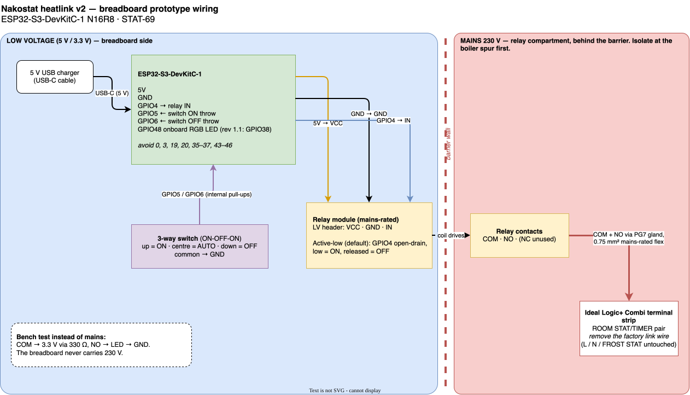

# Heatlink prototype: wiring, bench test and live trial

STAT-69 / STAT-74. Design: [`superpowers/specs/2026-10-19-heatlink-v2-prototype-design.md`](superpowers/specs/2026-10-19-heatlink-v2-prototype-design.md).

> **⚠️ 230 V.** The Ideal Logic+ Combi switches its call for heat at mains voltage. The breadboard
> never carries mains. For the live trial, only the relay module's COM/NO screw terminals do, inside
> the printed case's mains compartment. Isolate the boiler at its double-pole spur before opening
> anything, and **have a qualified person check the installation before the trial**.

## Parts

| Part | Notes |
|---|---|
| ESP32-S3-DevKitC-1 N16R8 | Any revision. The RGB LED is on GPIO48 (rev 1.0) or GPIO38 (rev 1.1): set `HEATLINK_LED_GPIO` in menuconfig |
| Mains-rated single-channel relay module | 5 V coil, opto-isolated, contacts ≥ 250 V AC. Note whether it triggers on **low** (default) or **high** |
| 3-way switch | ON-OFF-ON toggle or a 3-position rotary: two throws and a common |
| Half-size breadboard, jumper wires | DevKitC straddles the centre channel |
| 5 V USB charger + USB-C cable | ≥ 1 A |
| For the bench test: LED + 330 Ω | Dummy load on the relay contacts |
| For the trial: printed case (`3d/heatlink-prototype/`), PG7 gland, 0.75 mm² mains-rated 2-core flex, M3 screws and inserts | Print in PETG or ASA |

## Pin map

| DevKitC pin | Goes to | Why |
|---|---|---|
| 5V | Relay module VCC | The coil needs 5 V |
| GND | Relay module GND; switch common | |
| GPIO4 | Relay module IN | Active-low modules: open-drain (low = on, released = off), so the relay is off while the GPIO floats at boot |
| GPIO5 | Switch "ON" throw | Internal pull-up; reads low when the switch is up |
| GPIO6 | Switch "OFF" throw | Internal pull-up; reads low when the switch is down |
| (onboard) GPIO48 | RGB status LED | Already on the board |

The centre position (neither throw connected) is **AUTO**. Avoid GPIO 0, 3, 45 and 46 (strapping
pins), 19 and 20 (USB), 35–37 (the N16R8's octal PSRAM) and 43–44 (UART0).

**Relay trigger level.** If your module triggers on **high** (check its jumper or the listing), set
`HEATLINK_RELAY_ACTIVE_LOW=n` in menuconfig. The firmware then drives GPIO4 push-pull instead.

## 1. Bench test (no mains)

1. Wire the DevKitC, relay module and switch as above. On the relay contacts: **COM** goes to 3.3 V
   through 330 Ω, and **NO** goes to the LED anode, LED cathode to GND.
2. Flash and provision (see `embedded/esp32/heatlink/README.md`).
3. With the switch in each position, check the LED colour and the relay:

| Check | Expect |
|---|---|
| Switch **up** | Relay clicks on, dummy LED lit, status LED purple, status `mode:"force_on"` |
| Switch **down** | Relay off, purple, `mode:"force_off"` |
| Switch **centre**, daemon running (sandbox) | Status LED green (idle) or orange (heating). The relay follows the daemon's demand; `mode:"auto"` |
| Raise the setpoint above room temperature from the web dashboard | Within ~30 s: relay on, orange |
| Stop the daemon and wait 5 min | Blue, `mode:"fallback"`. Relay follows the schedule's comfort periods with a 40 min on / 20 min off duty cycle |
| Unplug the router | Red blinking. Fallback continues from the stored schedule |
| Power-cycle with no network | Relay stays **off** until demand arrives, or fallback starts after 5 min (once time is known) |

## 2. Live trial

Only after the bench test passes.

1. Mount the relay module in the case's mains compartment. Fit the gland. Pass the low-voltage
   jumpers (VCC/GND/IN) through the small slot in the barrier; nothing else crosses it.
2. **Isolate the boiler** at its double-pole fused spur. Confirm it is dead with a tester.
3. Open the boiler's terminal cover (Ideal manual, Frames 30–32). On the strip, find the two
   **ROOM STAT/TIMER** terminals. Remove the factory **link wire** between them and **keep it** (see
   *Rolling back*).
4. Run the 2-core flex from those two terminals, through the gland, to the relay's **COM** and **NO**.
   Polarity doesn't matter: the contact just replaces the link. Leave **NC** empty. Don't touch
   L, N or FROST STAT.
5. Close the case, restore power at the spur, and repeat the bench-test table with the boiler
   instead of the LED. "Relay on" should now light the boiler's heating demand and fire it.
6. Run the trial (suggested: a week). Watch the dashboard's boiler timeline against the room temperature.

## Rolling back

Something wrong mid-trial:
- **Switch up** forces heat on and **switch down** forces it off. Both work with no network.
- **Permanent fallback** without the heatlink: isolate, remove the flex, and re-fit the factory link
  wire. The boiler then calls for heat permanently, as it did out of the box.
