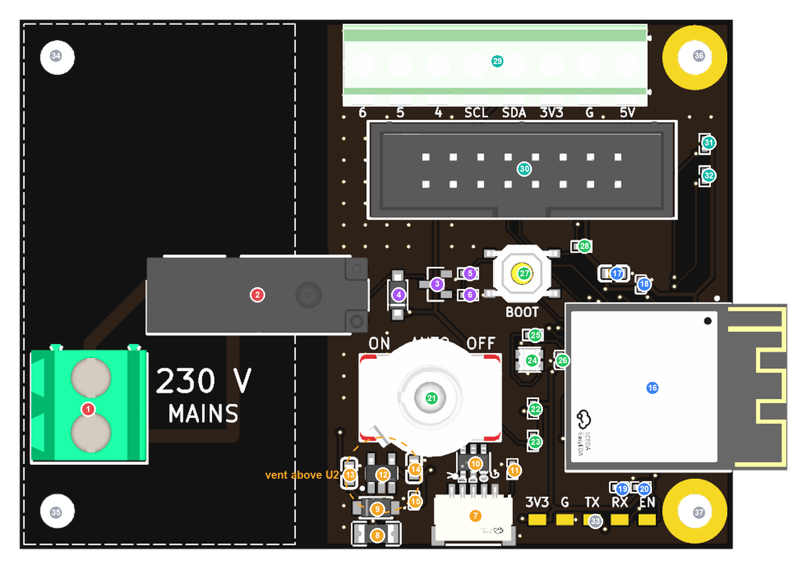

# Heatlink board: what each part does, and why

<!-- Generated by board/key.py (build.py, or `python -m board.key`). Edit the text there. -->

Top view, 66 × 49 mm. The mains end (dashed outline) is on the left; the antenna overhangs the right edge. The dashed orange ring marks where the case needs a vent: above the regulator, U2.

## 230 V mains

The only part of the board at 230 V. It sits at one end, inside the dashed outline, at least 8 mm from everything else (more than reinforced insulation needs), with no copper pour, so nothing low-voltage can reach it.

| # | Ref | Part | What it does | Why it's there |
|---|---|---|---|---|
| 1 | J2 | Kefa KF128 2-way screw terminal | The boiler's L and SL, in place of the link wire | Screw terminals take the boiler's mains flex without soldering. The 5.08 mm pitch keeps L and SL over 2.5 mm apart, and the openings face the cable gland. |
| 2 | K1 | Hongfa HF46F/5-HS1 relay | 5 V coil; its contact joins L to SL to call for heat | A relay puts a physical gap between the 5 V electronics and 230 V. This one is rated for reinforced insulation between coil and contacts, so it can bridge the mains boundary on its own. Its 5 A rating is far beyond the milliamp signal, so it won't wear. |

## USB power and protection

Brings 5 V in from the USB cable, protects the board against shorts, spikes, static and a reversed cable, then makes the 3.3 V the electronics run on.

| # | Ref | Part | What it does | Why it's there |
|---|---|---|---|---|
| 7 | J1 | JST SM05B-SRSS (house USB) | 5 V power and USB data in | The house USB connector, the same on every one of Martin's boards: one cable for power and flashing, and no mains power supply on the board. |
| 8 | F1 | 1206L050 polyfuse | 500 mA resettable fuse on 5 V | If anything shorts on the 5 V side (a stray wire on J3/J4, a failed part) it heats up and cuts the current, then resets once the fault is gone. There's no fuse to replace. |
| 9 | D2 | SMF5.0A TVS diode | Clamps spikes on 5 V | Absorbs voltage spikes on the 5 V line. If a miswired cable ever feeds reversed voltage, it conducts hard and trips F1, protecting everything after it. |
| 10 | U3 | USBLC6-2SC6 | ESD protection on USB D+ and D− | The USB data lines go straight into the ESP32, and static from a finger or a cable could kill it. This chip diverts those zaps to ground. |
| 11 | R1 | 5.1 kΩ | CC pull-down | A USB-C charger only switches 5 V on when it sees this resistor on the CC wire. Without it, a USB-C charger would supply nothing. |
| 12 | U2 | AP2112K-3.3 regulator | 5 V to 3.3 V, up to 600 mA | The ESP32 runs at 3.3 V and USB supplies 5 V. A linear regulator is simple and quiet, but turns the 1.7 V difference into heat (about 0.2 W on average, 0.6 W in Wi-Fi bursts). It's the warmest part on the board, so the case has a vent above it. |
| 13 | C1 | 10 µF | Regulator input | A local reservoir, so the regulator doesn't see dips when the load jumps. |
| 14 | C2 | 10 µF | Regulator output | The regulator needs it to stay stable, and it supplies Wi-Fi's sudden current bursts. |
| 15 | C3 | 100 nF | Regulator output | Handles the high-frequency noise the larger capacitor is too slow for. |

## Relay driver

Turns a weak 3.3 V GPIO signal into enough current for the relay coil, and makes sure the relay is off whenever the firmware isn't in control.

| # | Ref | Part | What it does | Why it's there |
|---|---|---|---|---|
| 3 | Q1 | AO3400A N-MOSFET | Switches the relay coil to GND | A GPIO gives a few milliamps at 3.3 V; the coil needs 40 mA at 5 V. The MOSFET is the switch in between, and this one turns fully on with 3.3 V on its gate. |
| 4 | D3 | 1N4148W diode | Flyback clamp across the coil | When the coil switches off, its collapsing magnetic field kicks back a voltage spike. The diode gives that energy a safe path so it can't damage Q1. |
| 5 | R7 | 100 Ω | Gate resistor, GPIO 12 to Q1 | Limits the current pulse into the MOSFET's gate as it switches, keeping the edges clean. |
| 6 | R8 | 100 kΩ | Gate pull-down | While the ESP32 is booting or resetting, its pins float. This holds the gate low, so the relay and the boiler stay off until the firmware turns them on: fail-safe. |

## ESP32 module and support

The ESP32-S3 runs the firmware: Wi-Fi, MQTT to AWS, the fallback schedule and OTA updates. Its support parts give it clean power and a clean start.

| # | Ref | Part | What it does | Why it's there |
|---|---|---|---|---|
| 16 | U1 | ESP32-S3-MINI-1-N8 module | The brain: Wi-Fi, CPU and 8 MB of flash | A pre-certified module (radio, antenna and flash already designed and approved), so the board needs no RF design. It sits at the far end from the mains, with the antenna hanging off the edge, clear of copper that would detune it. |
| 17 | C4 | 10 µF | Module 3V3 decoupling | Wi-Fi bursts draw sharp current spikes. Capacitors at the module's power pin supply them instantly, so the voltage doesn't sag and crash the chip. |
| 18 | C5 | 100 nF | Module 3V3 decoupling | Partners C4 for the higher-frequency part of that noise. |
| 19 | C6 | 1 µF | EN reset delay | With R2, holds the chip in reset for a few milliseconds at power-up, until the supply is steady. Espressif's recommended values. |
| 20 | R2 | 10 kΩ | EN pull-up | Pulls the chip's enable pin high so it runs; with C6 it sets the start-up delay. |

## Switch, button and LED

The local controls and indicator, so the heatlink can be used and diagnosed standing at the boiler with no phone or network.

| # | Ref | Part | What it does | Why it's there |
|---|---|---|---|---|
| 21 | SW2 | MTS-103 ON-OFF-ON toggle | Override: ON, AUTO or OFF | A physical override that works with no Wi-Fi or cloud: up forces the heating on, down forces it off, and the centre lets the system decide. Its bushing comes through the lid. |
| 22 | R9 | 10 kΩ | Toggle 'on' pull-up (GPIO 13) | Gives the input a defined high level; the switch pulls it to ground when selected. |
| 23 | R10 | 10 kΩ | Toggle 'off' pull-up (GPIO 14) | The same for 'off'. With neither input pulled low, the firmware knows it's in AUTO. |
| 24 | D1 | WS2812B-2020 RGB LED | Status LED, under a light pipe | Shows heating, idle, fallback or no Wi-Fi at a glance: any colour from one part and one data pin. |
| 25 | R6 | 330 Ω | LED data resistor (GPIO 15) | Damps ringing on the LED's fast data line and protects the GPIO. |
| 26 | C8 | 100 nF | LED decoupling | The LED draws current in sharp pulses; this keeps them off the 3.3 V supply. |
| 27 | SW1 | TS-1187A button | BOOT (GPIO 0) | Holding BOOT at power-up starts the ESP32's built-in bootloader, so a board with broken firmware can always be reflashed over USB. |
| 28 | R3 | 10 kΩ | BOOT pull-up | Keeps GPIO 0 high, so the board starts normally unless BOOT is pressed. |

## Reuse I/O

Not used by the heatlink. They make the spare boards reusable as general Wi-Fi I/O boards.

| # | Ref | Part | What it does | Why it's there |
|---|---|---|---|---|
| 29 | J3 | DORABO 8-way 3.5 mm terminal | 5V, G, 3V3, SDA, SCL, GPIO 4/5/6 | Power, I²C and three GPIOs on screw terminals, for reusing spare boards. Keep loads small (about 100 mA from 3V3, 150 mA from 5V). |
| 30 | J4 | 16-way boxed IDC header | 3V3, 5V, two GNDs and 12 GPIOs | A keyed ribbon-cable header for reuse, with grounds between the signal groups to keep ribbon signals clean. The STAT-77 round display plugs in here. |
| 31 | R4 | 4.7 kΩ | I²C SDA pull-up | I²C devices only ever pull the lines low, so something has to pull them high. Fitting these means sensors just plug in. |
| 32 | R5 | 4.7 kΩ | I²C SCL pull-up | As R4, for the clock line. |

## Mounting and recovery

Mounting holes and the serial recovery port.

| # | Ref | Part | What it does | Why it's there |
|---|---|---|---|---|
| 33 | TP1 | Debug pads | 3V3, G, TX, RX, EN | A back door: if USB is ever unusable, a USB-serial adapter on these pads can still flash and debug the chip. |
| 34 | H1 | M3 hole, unplated | Mounting, mains end | Unplated with no copper, so a screw here connects to nothing. Use a nylon screw. |
| 35 | H2 | M3 hole, unplated | Mounting, mains end | As H1. A metal screw and washer here would sit within 3 mm of J2, so use nylon. |
| 36 | H3 | M3 hole, plated | Mounting | Plated and on GND, so a metal standoff here also grounds the board. |
| 37 | H4 | M3 hole, plated | Mounting | As H3. |

Chi's artwork, the credit and the board name are on the back, in silkscreen only.
