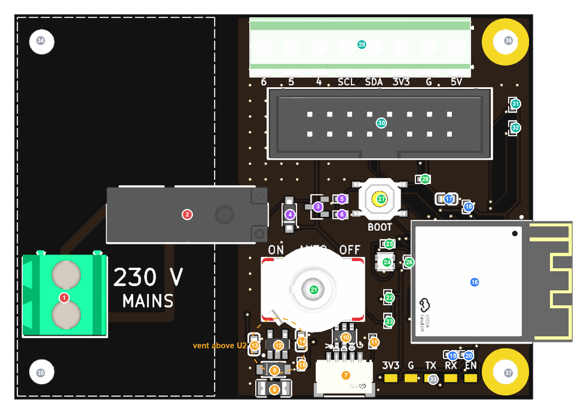

# Nakostat heatlink board (STAT-75)

The heatlink on one board: an ESP32-S3-MINI-1 module, a relay on the boiler's 230 V
`ROOM STAT/TIMER` pair, the 3-way override toggle, a WS2812B status LED, and, to make spare boards
reusable, an 8-way IO terminal (power, I²C and three GPIOs) and a 16-way IDC header (twelve more). It is powered over the
house USB cable. The board is generated in code, from the circuit through to the gerbers, using
tinycrypt's pipeline. `DESIGN.md` covers the parts, the circuit and the mains safety rules.

[](../../docs/heatlink-board-key.md)

**[The component key](../../docs/heatlink-board-key.md)** explains what every numbered part does, and why it's there. The dashed orange
ring marks where the case needs a vent: above the 3.3 V regulator (U2), the warmest part.

## Build

```bash
ASDF_PYTHON_VERSION=3.11.15 python -m venv .venv
.venv/bin/pip install -r requirements.txt
mkdir -p freerouting && cp <somewhere>/freerouting-2.5.0.jar freerouting/   # Java via asdf (25)
./fetch_parts.sh                       # only if footprints/ is missing or a part is added
.venv/bin/python build.py --route      # full router log: /tmp/claude-501/heatlink-board-route.log
.venv/bin/python -m pytest
```

`build.py` writes these to `out/heatlink/`:

- `nakostat-heatlink.kicad_pcb`, with its `.kicad_pro` and `.kicad_dru` (the mains rules)
- `drc.json`
- `bom-jlcpcb.csv` and `bom-pcbway.csv`
- `cpl.csv`
- `nakostat-heatlink-gerbers.zip`
- the top and bottom renders
- `pins.h`
- `nakostat-heatlink-key.png` and `docs/heatlink-board-key.md` (the text lives in `board/key.py`; after editing it,
  `.venv/bin/python -m board.key` redraws both from the existing render without a rebuild)

It writes the fab files only when KiCad's DRC reports no errors and no unconnected items. Those
checks include the 8 mm mains spacing. `--step` also fetches the 3D models and writes
`nakostat-heatlink.step` and a 3D render, which the case design needs.

## Made by PCBWay (sponsored)

The first five boards (November 2026) were manufactured and assembled by
[PCBWay](https://www.pcbway.com), who sponsored the build: they covered the boards, the parts and the
assembly. The files here aren't tied to them; the same gerbers and placement file, with
`bom-jlcpcb.csv`, also work at JLCPCB.

## Ordering

The same files work for both fabs. Only the BOM differs.

| | PCBWay | JLCPCB |
|---|---|---|
| Gerbers | `nakostat-heatlink-gerbers.zip` | same |
| BOM | `bom-pcbway.csv` (manufacturer + part number) | `bom-jlcpcb.csv` (LCSC numbers) |
| Placement | `cpl.csv` | same |

- 2 layers, 1.6 mm, **ENIG**, **black** mask, white silkscreen.
- Assembly is top side only. Five parts are through-hole: K1 (relay), J2 and J3 (terminal blocks),
  J4 (IDC header) and SW2 (toggle switch).
- The module's antenna **overhangs the board edge by 5.05 mm on purpose**. If the engineering
  review asks, say the overhang is intended.
- The board carries 230 V between J2 and the relay contacts. There is no ground pour in that area,
  and it is marked on both silkscreens.
- Check the rotations of U1, J1, J2, J3, J4, K1 and SW2 in the fab's placement preview.

## Before the first power-up

- **Check the USB cable's pinout with a meter:** 1 VBUS, 2 D−, 3 D+, 4 CC, 5 GND. A reversed VBUS
  trips the resettable fuse, but the data lines have no protection against a wrong cable.
- **Bench-test first with no mains connected.** Use the same steps as the prototype
  (`docs/heatlink-prototype-wiring.md`): the relay should click on demand, and the toggle should
  override it.
- **Wire the boiler with the power off at the spur.** L and SL go to J2 in place of the link wire.
  Fit bootlace ferrules to the flex, and clamp it in the gland so no pull reaches J2.
- **Use nylon screws in the two mains-end holes (H1, H2).** A metal M3 screw and washer in H2 would
  sit about 2.9 mm from J2, inside the board's own 3 mm rule.
- **Use a reputable, certified USB charger.** Its isolation is the real barrier between the mains
  and everything on the low-voltage side, including J3 and J4.
- **Keep loads on J3 and J4 small:** about 100 mA from 3V3 and 150 mA from 5V. The 3V3 regulator
  runs warm at sustained loads, and the 500 mA polyfuse is shared with the relay and the module,
  so a short on a header's 5V pin drops the heating control until it's removed.
- **House it in a flame-retardant enclosure** (UL94 V-0, e.g. a bought ABS or PC box, or a V-0
  filament), not PETG or ASA, because the case holds the 230 V terminals.
